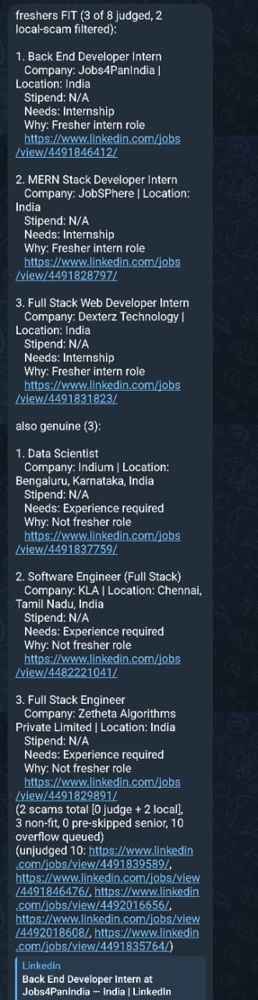
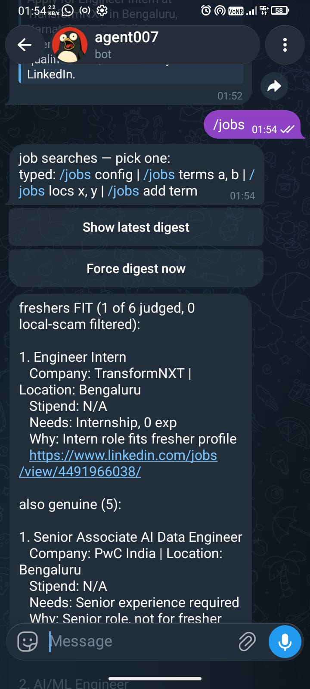

# Fresher Job Radar

> An autonomous job-intelligence agent that runs on a recycled Android tablet and delivers curated, scam-free fresher job leads to Telegram every 30 minutes.

Built on a **Lenovo Yoga Tab 3 10 LTE** (2015, 900 MB RAM, ARMv7, broken LTE radio) repurposed into a headless home server. No cloud VM, no paid APIs, no Docker — just Python stdlib, a 30-line loop, and a lot of attention to failure modes.

---

## The problem

Finding entry-level AI/ML/SDE roles in India means watching LinkedIn for a few hours a day. The feed is noisy: "up to ₹15,000 (performance-based)" internships, data-entry scams, course sellers, and senior roles dressed up as "intern." Good postings fall out of the 1-hour search window fast, so checking twice a day is already too slow.

The constraint: no server budget. The only always-on machine available was an old tablet with less RAM than a Raspberry Pi and no working cellular radio.

## What it does

```
LinkedIn guest search  ──paced──▶  SQLite store  ──30-min──▶  Groq judge  ──▶  Telegram digest
   (10 query pairs)                 (dedupe 4h)     (scam/fit)          (FIT only + counts)
        ▲                                                                     │
        └──────────────── one gateway bot, Cloudflare tunnel ◀────────────────┘
```

- **Collects** across all 10 keyword × location pairs, at **≤2 HTTP requests/minute** with randomized gaps — one search + one detail page per tick.
- **Judges** each new posting with a single Groq call per window: two flags, `scam` and `fit`, plus a short reason.
- **Filters scams twice**: a local regex pre-filter (any "up to ₹X" stipend, pay-to-join, Telegram-only application, data-entry, etc.) *and* a strict LLM prompt. The local filter also overrides the LLM — defense in depth.
- **Delivers** one digest every 30 minutes: FIT roles with links, plus an explicit "nothing new" heartbeat, so silence always means "healthy but empty," never "broken."
- **Runs unattended**: Termux:Boot autostart, kernel wake lock, survives screen-off and power-off (self-heals in ~3 min). Remote SSH via a Cloudflare tunnel — no router access, no open ports.

## Live demo



The bot has been running unattended on the tablet since October 2026. The digest above is generated end-to-end by the pipeline below — no human in the loop. Note the `2 scams total [0 judge + 2 local]` line: the local pre-filter caught fake "up-to-stipend" postings that the LLM marked as genuine.



It's not just a one-way feed — `/jobs` opens an inline keyboard for the latest digest or a forced scan.

A second digest example (FIT + genuine breakdown) is in [`docs/digest-example-2.jpg`](docs/digest-example-2.jpg). Chat IDs and personal contacts are cropped out of all captures.

## Why it's built this way (the interesting part)

Every mechanism here is a response to a failure that actually happened in production.

| Failure observed | Design response |
|---|---|
| Bursts of 15–28 requests got LinkedIn 429s and anti-bot challenge pages | Paced collector: ≤2 req/min, 8–16 s jitter, throttled pair skipped for the rest of the window, 240 s loop backoff |
| Alerts spooled for Telegram were **silently deleted when the send failed** during a DNS outage | `.fail` sidecar counter: file is deleted only after ≥1 recipient confirms receipt; dropped as poison after 50 fails |
| "Up to ₹X" internships kept landing in the FIT section | Local pre-filter + strict LLM prompt + post-judge override |
| Two schedulers (boot + manual) stacked → duplicate digests | pidfile guard, single-writer store |
| A trailing comma in config.json killed the process → total silence | Config parse errors now spool an explicit ALARM instead of dying mute |
| A hotspot DNS flap produced 25 identical "markup changed" alarms | Cause-classified alarms (429 / challenge / DNS Errno 7 / parser-zero) capped at 1 per 2 h, with raw fetch logs in a `crawls` table. The 25-run alarm was **root-caused to DNS, not markup**. |
| 30-min windows overlap a 1-hour LinkedIn search window → duplicates | Dedupe rows persisted for 4 h; each digest clears only payloads, never job IDs |
| Groq free tier: ~8k tokens/min | Batch capped to 6 jobs × 450-char descriptions |

## Failure modes handled explicitly

- HTTP 429 / 999 → stop the whole run, no hammering
- Anti-bot challenge page → detected and skipped (never fed to the judge)
- DNS `Errno 7` → in-run retry ×3, plus a `NET-DIAG` line that pings `1.1.1.1` by IP to distinguish "DNS dead" from "data path dead"
- Judge failure → digest ships raw links instead of going silent, and those rows are marked sent so they aren't re-judged forever
- Empty window → heartbeat message, not silence
- Poison alert file → 50-fail cap, so a permanently undeliverable message can't wedge the queue

## Results

- 30-minute end-to-end freshness, sustained over weeks
- Peak request rate cut ~7× versus the original burst design
- 10 keyword/location pairs swept per window with round-robin coverage
- 12 "up-to-stipend" scam postings identified in the store during validation
- Judge round-trip ~1–2 s, valid JSON, correct scam/FIT flags
- Zero application-level downtime; the two multi-hour outages were traced to the hotspot's DNS layer, not the code

## Stack

Python 3.12 (stdlib + `requests`), SQLite, Groq API, Telegram Bot API, Cloudflare Tunnel, Termux on LineageOS 17.1. Total footprint ~50 MB. The tablet's 900 MB RAM ceiling is why there is no Docker, no local LLM, and no framework-heavy code — every dependency was a deliberate "no."

## Honest limitations

- Uses LinkedIn's **guest** endpoint — no login, no applicant-only fields.
- A markup change on LinkedIn needs a small manual parser fix (there's an alarm for it).
- The tablet's hotspot DNS still flaps occasionally; the app survives it but coverage dips during a flap. An off-tablet watchdog is the remaining gap.
- The judge batch is capped at 6 jobs/window by the free-tier token budget; overflow ships in the next digest.

## Layout

```
Job Scrapper/   scraper.py (collector + digest), loop.sh, config.json, PRD.md
scripts/        telebot.py (gateway bot), boot scripts
TRACKER.md      decision log — every fix above is recorded with its evidence
TABLET.md       build handbook for this ARMv7 device
MANUAL.md       operator guide
```

## Run it

Deploy the four files in `Job Scrapper/` and `scripts/` to `~/code/jobscrapper/` and `~/code/telebot/` on a Termux box, set `GROQ_API_KEY` and `TBOT_TOKEN`, then:

```bash
nohup bash ~/code/jobscrapper/loop.sh > ~/code/jobscrapper/loop.log 2>&1 &
bash ~/.termux/boot/start-tbot
```

`/jobs run-now` on Telegram triggers an immediate collect + digest without waiting for the boundary.
